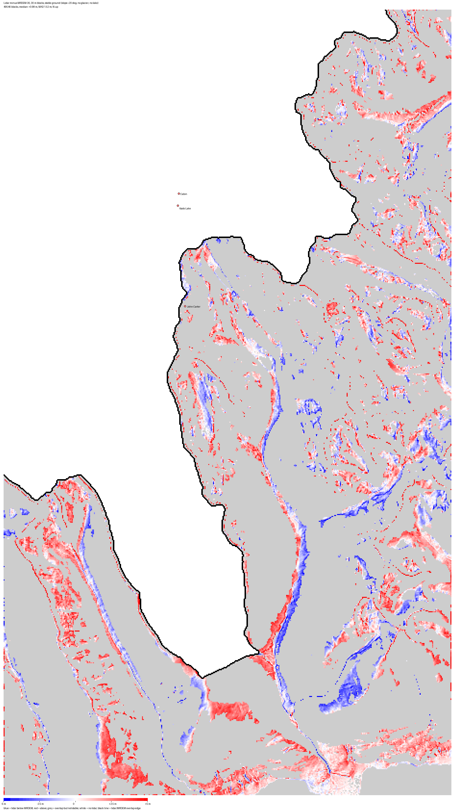

# Decision record: vertical datums of DEM sources

Status: **pilot checked** (2026-11-23). Lidar − MRDEM on stable ground at 30 m: median +0.5 m, MAD 1.4 m, no spatial trend. **No correction applied.** The lidar datum (probably CGVD28) is still unconfirmed from the LidarBC metadata. Repeat the check at full scope.

| Source | Vertical datum | Evidence |
|---|---|---|
| LidarBC 1 m DEM (2018, `bc_082f0*_l1m_utm11_20180830`) | **Probably CGVD28** (BC's established datum; GNSS heights via HTv2.0). *Not confirmed:* the GeoTIFF carries no vertical CRS keys | BC vertical reference system pages. Confirm from the LidarBC project metadata if obtainable |
| NRCan HRDEM / HRDEM Mosaic | CGVD2013 | NRCan product specification |
| NRCan MRDEM-30 | CGVD2013 | NRCan MRDEM product specification; STAC item `mrdem` (EPSG:3979) |

## Expected size of the difference
PROJ was used to transform CGVD28 (HT2_2010v70) to CGVD2013 (CGG2013n83). The result at 4 points across the bounding box:

| Point | CGVD2013 − CGVD28 |
|---|---|
| Cabin | +0.195 m |
| Cond Peak | +0.205 m |
| Robert Smith | +0.217 m |
| South end | +0.170 m |

The difference is about +0.2 m everywhere: smooth and tiny compared with MRDEM's vertical error (metres). **No datum correction will be applied for this reason alone.**

## Overlap check and correction (WS1 step 3, FULL bbox)
Method (`tools/build_terrain.py --scope full`, evidence in `build/residual_stats.json`, not committed): lidar and MRDEM warped to the 2 m analysis grid, block-meaned to 30 m, differenced **before any correction**. Stable ground only: slope under 20 deg on the 30 m aggregate, glaciers excluded (`web/data/basemap.geojson`), lakes excluded (dead-flat blocks). Residual = lidar minus fallback. Full bbox E 480,500-494,500, N 5,494,500-5,519,000.

| Pair | Stable 30 m blocks | Median (m) | MAD (m) | P10 / P90 (m) | Planar fit (const; dE, dN per km) | RMS before -> after |
|---|---|---|---|---|---|---|
| LidarBC 2018 - MRDEM | 37,904 | +0.78 | 1.47 | -2.4 / +3.3 | +0.71 m; -0.014, -0.001 m/km | 2.248 -> 2.244 m |
| HRDEM 2017 - MRDEM | 49,546 | +0.98 | 1.52 | -2.2 / +3.5 | +1.01 m; -0.070, +0.002 m/km | 2.301 -> 2.282 m |
| LidarBC 2018 - HRDEM 2017 | 37,904 | 0.00 | 0.003 | -0.01 / +0.01 | -0.003 m; 0, 0 | 0.043 -> 0.043 m |

Findings:
- **The two lidar products are the same data over the whole overlap** (MAD 3 mm, every 2 km sub-block 0.00 to 0.01 m, no elevation trend). No 2018/2017 seam, no relative offset. Vertical datum of the local tiles stays unconfirmed; any datum error is below about 0.2 m.
- **Lidar sits about 0.8-1.0 m above MRDEM** at the median, with MAD about 1.5 m. Median by 2 km sub-block (n >= 40) ranges -2.1 to +3.3 m with sign changes across neighbouring blocks (patchy, not regional).
- **No horizontal trend:** planar fits remove under 1% of RMS; tilt is 0.07 m/km at most (about 1 m over the 14 km bbox, inside the scatter).
- **Mild elevation dependence (reported, not corrected):** median residual by 200 m band for lidar2018 - MRDEM rises from -0.5 m (1200-1400) through +0.2 to +0.8 (1400-2200) to +1.3 (2200-2400), +1.0 (2400-2600) and +2.5 m (2600-2800, n=264). HRDEM 2017 shows the same shape (-0.4 to +2.7 m). Consistent with MRDEM 30 m smoothing clipping ridges and summits; on stable ground (<20 deg) it may also reflect the canopy/DSM character of MRDEM at low elevation. Steep and excluded ground has a larger median (+1.5 to +1.6 m), supporting a smoothing explanation rather than a datum shift.
- A constant or planar shift fitted on the lidar side would be extrapolated into the park core (MRDEM-only, 39.6% of the bbox), where it cannot be checked, and the elevation-dependent pattern is not removable by either.

**Decision (full): no vertical correction** (none, constant or planar) for MRDEM or either lidar product. The lidar to MRDEM step (about 0.8-1.0 m median, scatter to a few metres) is absorbed by the 150 m feather (`seam-report.md`: 32 of 1,601,330 band cells flagged, 0.002%). Flagged in ISSUES: MRDEM-only park core elevations may be about 1-2.5 m low at the highest summits relative to lidar.

**Residual map** (`tools/build_terrain.py --scope full --residual-png`): 
The map shows lidar minus MRDEM at 30 m on stable ground only. Residuals are patchy and local with no regional gradient or edge-to-edge tilt, which supports the "no correction" decision. See the elevation-dependence note above for the one systematic pattern.
